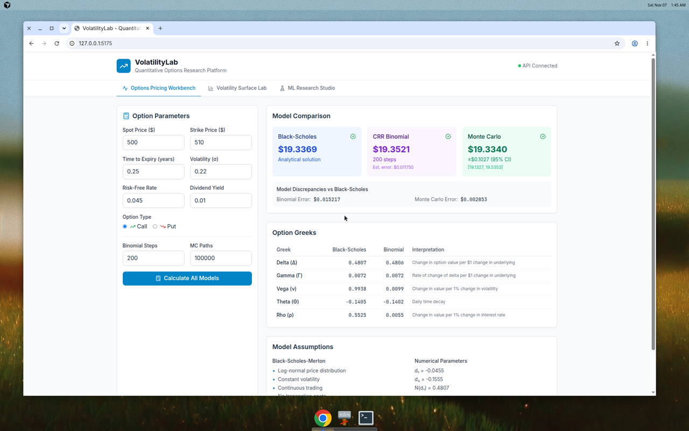
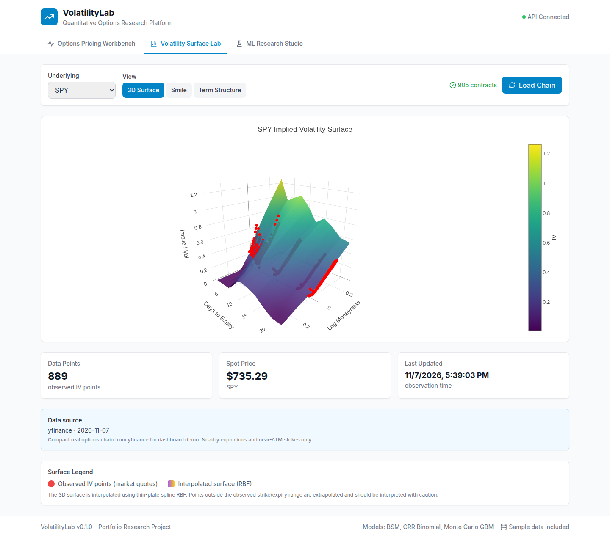
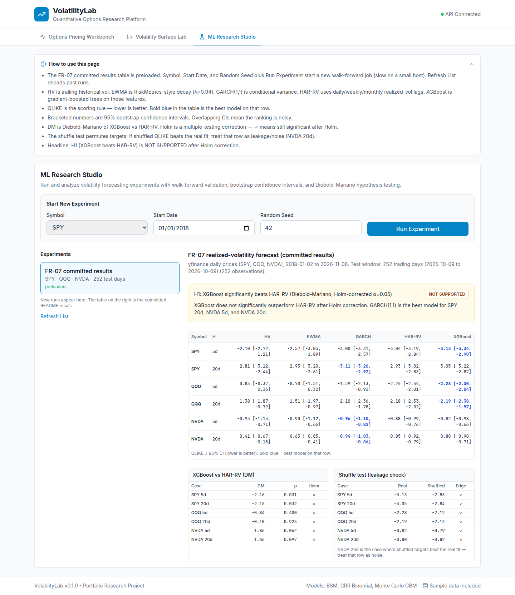
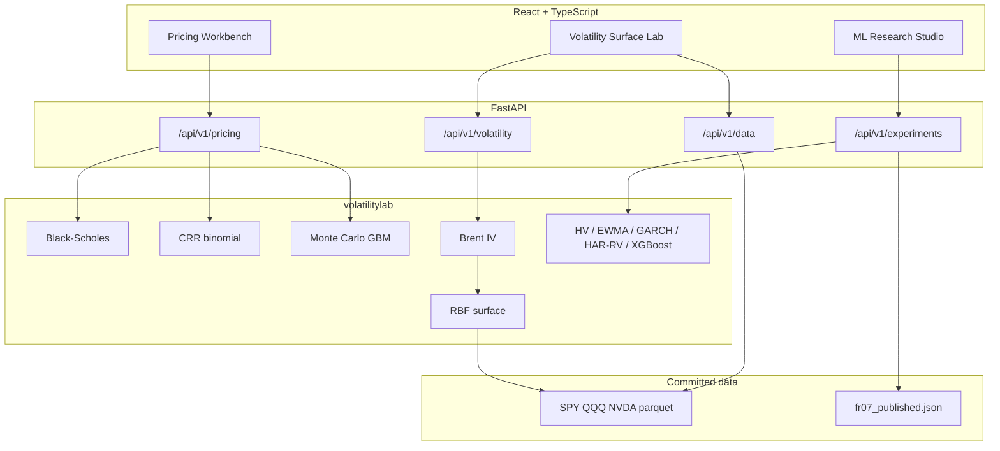

# VolatilityLab

**Options pricing, implied volatility, and realized-vol forecasting — with analytical Greeks for hedge ratios.**

[](https://volatilitylab-hd1l.onrender.com)
[](https://github.com/pabloapcv/volatility-lab/actions/workflows/ci.yml)
[](pyproject.toml)
[](https://github.com/pabloapcv/volatility-lab)
[](frontend/)
[](LICENSE)

## Live demo

Browser-only hosted desk (no install):

- **App:** https://volatilitylab-hd1l.onrender.com
- **API:** https://volatilitylab-api.onrender.com ([health](https://volatilitylab-api.onrender.com/health), [OpenAPI](https://volatilitylab-api.onrender.com/docs))

Free Render hosts sleep after idle time; the first load after a sleep is typically **30–60 seconds**. Later clicks are fast — implied-vol surfaces are cached in API memory.

The hosted UI is a light-themed three-tab desk. Each tab has a collapsible **How to use this page** panel (open on first visit).

VolatilityLab is a **research workbench**, not a trading platform and not a claim of forecast alpha.

---

## Why this project

A data-science master's portfolio should show that models are implemented correctly, that market data is handled with quality flags, and that a machine-learning headline is tested until it can fail.

This desk does those three things in one place: closed-form and numerical **European option prices** (plus Greeks), an **implied-vol surface** inverted from a real option chain, and a **walk-forward realized-vol study** that compares XGBoost to HAR-RV and GARCH with Diebold–Mariano tests and Holm correction. The headline result is negative: after multiple-testing correction, **XGBoost does not significantly beat HAR-RV**.

---

## Features

What the app actually ships — not a roadmap.

| Tab | What it does |
| --- | --- |
| **Options Pricing Workbench** | Prices a European call/put with Black–Scholes–Merton, a CRR binomial tree, and Monte Carlo GBM. Shows prices, a 95% MC interval, binomial error vs Black–Scholes, and Greeks (Δ, Γ, Vega, Θ, Rho). Vega and Rho are per **1%**. Seed is fixed at 42. |
| **Volatility Surface Lab** | Loads the committed SPY / QQQ / NVDA yfinance chain (observed 2026-11-07). Views: **3D surface**, **smile**, **term structure**. Axes are log-moneyness \(\ln(K/F)\), days to expiry, and IV. **Load Chain** fetches a fresh yfinance chain if the API can reach Yahoo. |
| **ML Research Studio** | Preloads the committed **FR-07** walk-forward table (QLIKE ± 95% CI, DM vs HAR-RV, shuffle leakage check). **Run Experiment** starts a new background job on the API (slow; needs ML extras + network). |

Also in the library / API, **not** on the workbench page:

- CRR binomial **American** exercise (API `exercise_style`; the UI always sends European).
- Monte Carlo **antithetic variates** (API default) and a **control variate** on the underlying (not an empirical hedge P&L).
- Bid / ask / mid implied vol and no-arbitrage bound rejection.

**Not in this version:** Heston, American Monte Carlo, VaR/ES, LSTM, or an empirical delta-hedging backtest.

---

## Screenshots

| Pricing Workbench | Volatility Surface | ML Research Studio |
| --- | --- | --- |
|  |  |  |

---

## Methodology

Full derivations and numerical tolerances: [docs/mathematical_models.md](docs/mathematical_models.md).

### Pricing models

**Black–Scholes–Merton** (closed form, analytical Greeks):

$$
C = S e^{-qT} N(d_1) - K e^{-rT} N(d_2)
$$

$$
d_1 = \frac{\ln(S/K) + (r - q + \sigma^2/2)T}{\sigma\sqrt{T}}, \qquad d_2 = d_1 - \sigma\sqrt{T}
$$

Put–call parity \(C - P = Se^{-qT} - Ke^{-rT}\) is checked in tests (tolerance \(< 10^{-6}\)).

**CRR binomial** (recombining tree; European in the UI, American on the API):

$$
u = e^{\sigma\sqrt{\Delta t}}, \quad d = 1/u, \quad p = \frac{e^{(r-q)\Delta t} - d}{u - d}
$$

European nodes take the discounted risk-neutral expectation; American nodes take \(\max(\text{continuation}, \text{intrinsic})\). Numerical Greeks come from the tree (finite differences). Convergence to Black–Scholes is \(O(1/N)\).

**Monte Carlo GBM** (European only):

$$
S_{t+\Delta t} = S_t \exp\left[(r - q - \sigma^2/2)\Delta t + \sigma\sqrt{\Delta t}\, Z\right], \quad Z\sim N(0,1)
$$

$$
\hat{V} = e^{-rT}\frac{1}{M}\sum_{i=1}^{M} \mathrm{payoff}(S_T^{(i)})
$$

The API default is antithetic variates. A control variate on \(S_T - S_0 e^{(r-q)T}\) is available on the API; the workbench does not expose that knob. The card reports a 95% CI from the Monte Carlo standard error.

### Implied-vol surface

Brent’s method inverts Black–Scholes on each valid quote (\(\sigma \in [10^{-6}, 5]\), price tolerance \(10^{-8}\)). Quotes outside European no-arbitrage bounds are rejected.

$$
\max(0, Se^{-qT} - Ke^{-rT}) \le C \le Se^{-qT}
$$

Observed IVs are interpolated onto a grid with a thin-plate-spline **RBF**. Points outside the observed strike/expiry range are flagged as extrapolated.

### Forecasting models

Forward realized variance at 5-day and 20-day horizons, from daily yfinance bars (not the option snapshots):

| Model | What it is |
| --- | --- |
| HV | 21-day historical variance |
| EWMA | RiskMetrics, \(\lambda = 0.94\) |
| GARCH(1,1) | Conditional variance via `arch` |
| HAR-RV | OLS on daily / weekly / monthly RV (Corsi 2009) |
| XGBoost | 100 trees, depth 4, point-in-time features |

HAR-RV:

$$
\mathrm{RV}_{t+h} = \beta_0 + \beta_d\,\mathrm{RV}^{(d)}_t + \beta_w\,\mathrm{RV}^{(w)}_t + \beta_m\,\mathrm{RV}^{(m)}_t + \varepsilon
$$

Daily RV is \(r_t^2 \times 252\); weekly and monthly are `rvar_5d` and `rvar_21d`. Coefficients are fit on the **train fold only**.

### Validation

Committed FR-07 protocol (`data/experiments/fr07_published.json`, reproduced with `python scripts/run_experiments.py`):

- Expanding walk-forward: 2-year initial train, 1-year held-out test (252 trading days, 2025-10-09 to 2026-10-09).
- Purge gap \(\max(5, h+1)\) days; embargo 20 days.
- Scoring rule: **QLIKE** (lower is better)

$$
\mathrm{QLIKE} = \log(\hat\sigma^2) + \sigma^2 / \hat\sigma^2
$$

- Stationary block bootstrap CIs (\(n = 500\)).
- Diebold–Mariano of XGBoost vs HAR-RV (HAC variance, Harvey–Leybourne–Newbold correction), then **Holm–Bonferroni** at \(\alpha = 0.05\).
- Shuffle test: permute targets; if shuffled QLIKE beats the real fit, treat the row as leakage / noise.

---

## Results (FR-07)

Committed artifact: [`data/experiments/fr07_published.json`](data/experiments/fr07_published.json). Price sample: yfinance daily bars, SPY / QQQ / NVDA, **2018-01-02 → 2026-11-06**. Test window: **252** observations.

**H1:** “XGBoost significantly beats HAR-RV” (DM, Holm-corrected \(\alpha = 0.05\)) — **NOT SUPPORTED**.

### QLIKE ± 95% CI (lower is better)

Bold is the best model on that row, from the JSON `best` field.

| Symbol | H | HV | EWMA | GARCH | HAR-RV | XGBoost |
| --- | --- | ---: | ---: | ---: | ---: | ---: |
| SPY | 5d | −2.099 [−2.718, −1.207] | −2.573 [−3.048, −1.889] | −3.004 [−3.307, −2.567] | −3.042 [−3.188, −2.843] | **−3.135** [−3.341, −2.897] |
| SPY | 20d | −2.813 [−3.119, −2.443] | −2.931 [−3.197, −2.609] | **−3.106** [−3.256, −2.924] | −2.933 [−3.023, −2.827] | −3.052 [−3.221, −2.868] |
| QQQ | 5d | +0.834 [−0.373, 2.362] | −0.703 [−1.510, 0.317] | −1.589 [−2.130, −0.905] | −2.244 [−2.438, −2.010] | **−2.277** [−2.499, −2.041] |
| QQQ | 20d | −1.377 [−1.867, −0.790] | −1.515 [−1.968, −0.971] | −2.096 [−2.359, −1.780] | −2.183 [−2.325, −2.019] | **−2.187** [−2.376, −1.968] |
| NVDA | 5d | −0.930 [−1.134, −0.709] | −0.900 [−1.121, −0.661] | **−0.965** [−1.098, −0.821] | −0.883 [−0.995, −0.759] | −0.818 [−0.984, −0.664] |
| NVDA | 20d | −0.406 [−0.673, −0.151] | −0.628 [−0.851, −0.415] | **−0.941** [−1.026, −0.860] | −0.852 [−0.921, −0.789] | −0.799 [−0.895, −0.712] |

QQQ 5d **HV is the only positive QLIKE** in the table; its CI crosses zero. GARCH wins SPY 20d and both NVDA horizons. XGBoost is **worst of the five** on NVDA 5d.

### H1 tests (XGBoost vs HAR-RV)

Every row has `significant_after_holm: false`. Raw \(p < 0.05\) on SPY is not enough once Holm is applied.

| Symbol | H | DM | \(p\) | Holm |
| --- | --- | ---: | ---: | --- |
| SPY | 5d | −2.161 | 0.031 | no |
| SPY | 20d | −2.151 | 0.032 | no |
| QQQ | 5d | −0.842 | 0.400 | no |
| QQQ | 20d | −0.097 | 0.923 | no |
| NVDA | 5d | +1.865 | 0.062 | no |
| NVDA | 20d | +1.657 | 0.097 | no |

Positive DM on NVDA means HAR-RV had the better QLIKE; XGBoost did not even win the raw comparison there.

### Shuffle test (leakage check)

| Symbol | H | Real QLIKE | Shuffled | Edge kept |
| --- | --- | ---: | ---: | --- |
| SPY | 5d | −3.135 | −2.834 | yes |
| SPY | 20d | −3.053 | −2.842 | yes |
| QQQ | 5d | −2.277 | −2.123 | yes |
| QQQ | 20d | −2.187 | −2.136 | yes |
| NVDA | 5d | −0.818 | −0.792 | yes |
| NVDA | 20d | −0.799 | **−0.818** | **no** |

NVDA 20d is the honest miss: shuffled targets beat the real fit. That row is noise, not a model edge.

MAE / RMSE for these forecasts are **not** in the committed JSON (the evaluation module can compute them; FR-07 reports QLIKE). Hedge-error or P&L metrics are **not computed** — there is no delta-hedging backtest in the repo.

---

## Data

Dashboard chains are **one compact trading-day snapshot**, not a full history.

| Symbol | Provider | Observed (UTC) | Spot | Contracts | Expiries |
| --- | --- | --- | ---: | ---: | --- |
| SPY | yfinance | 2026-11-07 17:39 | 735.29 | 905 | 2026-11-09 … 2026-11-30 (8) |
| QQQ | yfinance | 2026-11-07 17:39 | 656.10 | 776 | 2026-11-09 … 2026-11-30 (8) |
| NVDA | yfinance | 2026-11-07 17:39 | 186.64 | 269 | 2026-11-09 … 2026-12-18 (8) |

Source files: `data/snapshots/*_yfinance_sample_{cleaned.parquet,metadata.json}`. Built by [`scripts/fetch_real_snapshot.py`](scripts/fetch_real_snapshot.py): nearby expiries, strikes within ±15% of spot, valid quotes only. Synthetic `*_sample_offline_*` chains are the offline fallback if a real file is missing; `SnapshotManager.load_latest()` prefers the yfinance files.

Forecasting does **not** use those option files. FR-07 pulls **daily equity/ETF bars** (and lagged VIX as a feature) through yfinance in `src/volatilitylab/ml/features.py`.

**Load Chain** in the Surface Lab can request a live yfinance chain at runtime. The hosted demo’s default view is the committed snapshot above.

---

## Architecture



Hosted split: static/frontend service `volatilitylab-hd1l` talks to API service `volatilitylab-api` (`Dockerfile.backend`, bind `0.0.0.0:$PORT`). Local `make demo` runs both on :5175 and :8765.

---

## Tech stack

| Layer | Stack |
| --- | --- |
| Library | Python 3.12, NumPy, SciPy, pandas, Polars, PyArrow |
| API | FastAPI, Pydantic, Uvicorn |
| UI | React 18, TypeScript, Vite, Tailwind, Plotly, TanStack Query |
| Market data | yfinance → parquet snapshots |
| Forecasting extras | scikit-learn, XGBoost, statsmodels, arch (`pip install -e ".[ml]"`) |
| Tests | pytest, Hypothesis, pytest-cov |
| Lint | Ruff (check + format) |
| Deploy | Docker, Render (free web services) |

---

## Quick start

Requires **Python 3.12+** and **Node 18+**.

```bash
git clone https://github.com/pabloapcv/volatility-lab.git
cd volatility-lab
make demo
```

API: http://127.0.0.1:8765 · UI: http://127.0.0.1:5175 · OpenAPI: http://127.0.0.1:8765/docs

```bash
docker compose up --build          # same ports
pip install -e ".[dev,ml]"         # library + tests + forecasting extras
python scripts/run_experiments.py  # regenerate FR-07 (network + time)
```

Manual two-terminal run:

```bash
python -m uvicorn backend.app.main:app --host 0.0.0.0 --port 8765
cd frontend && npm ci && npm run dev
```

---

## Project structure

```
src/volatilitylab/     pricing, IV/surface, snapshots, ML
backend/app/           FastAPI routes and Pydantic schemas
frontend/src/          React tabs (Pricing, Surface, ML Studio)
tests/                 unit, numerical, integration, Hypothesis
data/snapshots/        committed SPY/QQQ/NVDA chains
data/experiments/      committed FR-07 JSON
docs/                  math note + screenshots + social preview
scripts/               demo, snapshot fetch, experiment runner
```

---

## Testing

```bash
make test
pytest tests/ --cov=src/volatilitylab --cov-report=term-missing
pytest tests/ -k "PropertyBased"
pytest tests/numerical/ -v
ruff check src/ tests/
ruff format --check src/ tests/
```

Coverage includes put–call parity, binomial → Black–Scholes convergence, Monte Carlo confidence intervals, IV round-trip, snapshot preference (real over synthetic), and API integration. Hypothesis property tests pin invariants across random valid parameters. `fail_under` in `pyproject.toml` is **50%** — there is no 85%+ coverage claim.

CI (`.github/workflows/ci.yml`) runs Ruff and pytest on every push and pull request.

---

## Roadmap and limitations

**Limits (read before citing numbers)**

- Option chains are a **compact one-day sample** (nearby expiries, near-ATM strikes). Weekend / short-dated quotes can show inflated IV — the Surface Lab says so.
- The workbench prices **Europeans**. American exercise is API-only; there is no American Monte Carlo.
- No stochastic-vol pricing (Heston is out of scope).
- ML gains are **modest and mostly insignificant** after Holm. NVDA 20d fails the shuffle test.
- Greeks are model sensitivities, not a backtested hedge. Delta-hedging P&L is not computed.
- Hosted demo is a free Render plan: cold start 30–60 s; live **Load Chain** needs Yahoo from the API host.

**Possible next work** (not built): Heston calibration, empirical delta-hedging backtest, VaR/ES, a deep-learning vol model beside HAR-RV / GARCH.

---

## License

[MIT](LICENSE) © 2026 Pablo Pena

---

## Author

**Pablo Pena** — [pabloapcv](https://github.com/pabloapcv)

Related: [Precious Metals Intelligence Platform](https://github.com/pabloapcv/Precious-Metals-Intelligence-Platform)

---

## References

- Black, F., & Scholes, M. (1973). *The Pricing of Options and Corporate Liabilities*
- Cox, J. C., Ross, S. A., & Rubinstein, M. (1979). *Option pricing: A simplified approach*
- Corsi, F. (2009). *A Simple Approximate Long-Memory Model of Realized Volatility*
- Glasserman, P. (2003). *Monte Carlo Methods in Financial Engineering*
